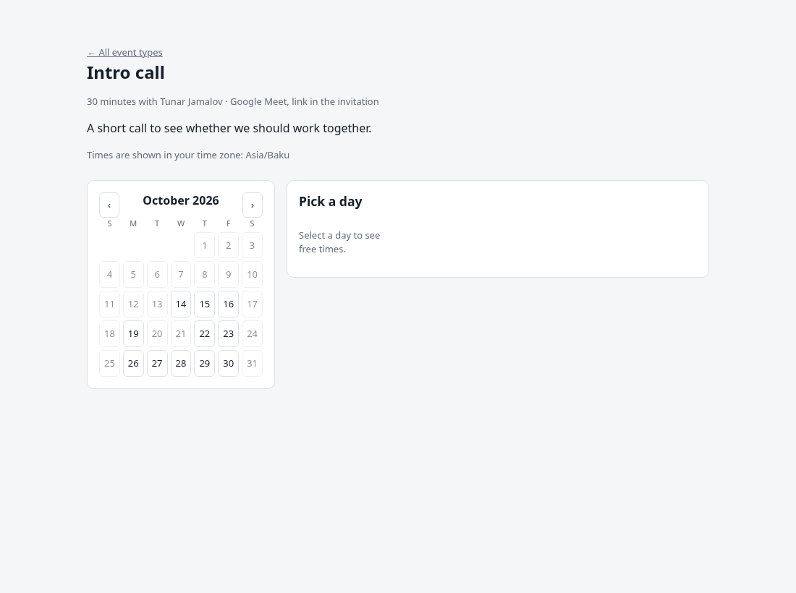
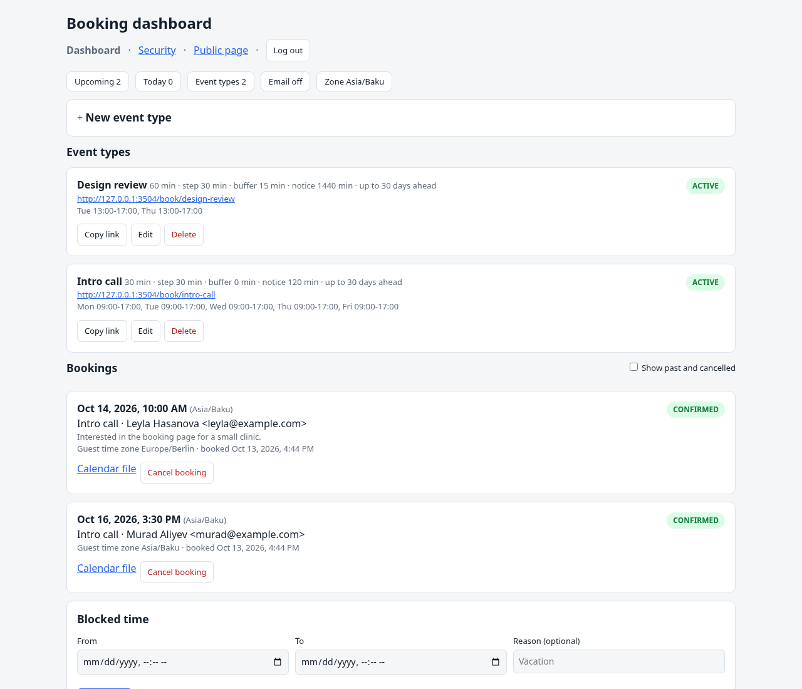

# Booking Page

A small, self-hosted alternative to hosted scheduling tools such as Calendly. Publish booking pages for your event types, let guests pick a free slot in their own time zone, and keep every booking in one SQLite file. It runs as a single Node.js process with no Redis, PostgreSQL, Docker, or external account required.



## Features

- Event types with duration, slot step, buffer around bookings, minimum notice, booking horizon, location, and description
- Weekly availability windows per event type in your time zone, plus manual blocked time (vacations, lunch)
- Public booking page with a calendar, free slots shown in the guest's time zone, and a confirmation screen
- Double-booking protection: the slot is re-checked at confirmation time
- Calendar invitations (.ics) for guests and the owner; confirmation and cancellation emails through SMTP
- Guest self-service cancellation through a private link
- Dashboard with event types, upcoming and past bookings, owner-side cancellation, and blocked time
- Admin sign-in with password plus optional TOTP two-factor authentication
- systemd unit and Docker image

## Requirements

Node.js 22 or newer and npm.

## Quick start

```sh
git clone https://github.com/TunarJamalov/booking-page.git
cd booking-page
npm install
cp .env.example .env     # set TIMEZONE, OWNER_NAME and BASE_URL
npm run dev
```

Open `http://localhost:3300/dashboard`, create an event type, and share its booking link (`/book/<slug>`). The home page lists every active event type.

| Command | Purpose |
| --- | --- |
| `npm run dev` | Run from TypeScript sources |
| `npm run build` / `npm start` | Compile to `dist/` and run the build |
| `npm test` | Run the test suite |
| `npm run lint` | Type-check and verify formatting |
| `npm run format` | Format sources with Prettier |



## How scheduling works

Availability is defined per event type as weekly windows (for example Monday to Friday, 09:00 to 17:00) in the `TIMEZONE` of the owner. For a requested day the service generates slots from each window in steps of `slotStepMinutes`, keeps those that fit the duration, and removes slots that:

- start before `minNoticeMinutes` from now or after `maxDaysAhead` days,
- overlap a confirmed booking, extended by `bufferMinutes` on both sides,
- overlap a blocked time range.

Guests see slots converted to their browser's time zone. When a guest confirms, the exact slot is validated again, so two guests cannot take the same time. Daylight saving changes are handled with the built-in `Intl` API; no time zone library is needed.

Each booking gets a private cancel link (`/cancel/<token>`) and a calendar file (`/cancel/<token>/invite.ics`). When SMTP is configured, the guest and the owner receive the invitation by email, and cancellations send an update.

## Email

Set `SMTP_HOST` and `ALERT_FROM` to enable email. `OWNER_EMAIL` receives the owner's copy; it defaults to `ALERT_FROM`. Without SMTP everything still works: guests get the calendar file and the cancel link on the confirmation screen.

## Admin authentication

Set `ADMIN_USERNAME`, `ADMIN_PASSWORD`, and `AUTH_ENCRYPTION_KEY` together to require sign-in for `/dashboard` and `/api/admin/*`. Generate the key with `openssl rand -base64 48`. Sessions last 8 hours, state-changing requests need the CSRF token the dashboard sends automatically, and failed sign-ins are rate limited. Enable TOTP on `/dashboard/security` and keep the recovery codes offline. Booking pages are always public.

Without admin credentials the dashboard is open. Only run it that way on a private network.

## Environment variables

| Variable | Default | Description |
| --- | --- | --- |
| `PORT` | `3300` | HTTP port |
| `HOST` | `0.0.0.0` | Listen address |
| `TRUST_PROXY` | `loopback` | Express `trust proxy` setting; `true` behind a remote reverse proxy |
| `DATABASE_PATH` | `./data/bookings.db` | SQLite database file |
| `BASE_URL` | request host | Public base URL used in emails and links |
| `TIMEZONE` | `UTC` | IANA zone for availability windows and the dashboard |
| `OWNER_NAME` | empty | Name shown to guests |
| `ADMIN_USERNAME` / `ADMIN_PASSWORD` | empty | Admin credentials; both required to enable sign-in |
| `AUTH_ENCRYPTION_KEY` | empty | Required with admin credentials; encrypts the TOTP secret |
| `SMTP_HOST` / `SMTP_PORT` / `SMTP_SECURE` | empty / `587` / `false` | SMTP server settings |
| `SMTP_USER` / `SMTP_PASSWORD` | empty | Optional SMTP credentials |
| `ALERT_FROM` | empty | Sender address; enables email together with `SMTP_HOST` |
| `OWNER_EMAIL` | `ALERT_FROM` | Where owner notifications go |

## API

Public endpoints: `GET /api/book/:slug` (event info and bookable days), `GET /api/book/:slug/slots?day=YYYY-MM-DD`, `POST /api/book/:slug` with `startsAt`, `name`, `email`, `notes`, `timeZone`, and `POST /api/cancel/:token`.

Admin endpoints under `/api/admin`: `overview`, `event-types` (list, create, update, delete), `bookings?past=true`, `bookings/:id/cancel`, and `blocks` (list, create, delete). Availability windows are sent as `{ "weekday": 1, "start": "09:00", "end": "17:00" }` with Sunday as weekday 0.

## Docker

```sh
cp .env.example .env   # edit it, then:
docker compose up -d --build
```

The container stores the database in `./data` and listens on port 3300.

## Production deployment

```sh
sudo useradd --system --home /opt/booking-page booking
sudo git clone https://github.com/TunarJamalov/booking-page.git /opt/booking-page
cd /opt/booking-page
sudo -u booking npm ci && sudo -u booking npm run build
sudo cp .env.example .env   # then edit .env
sudo cp systemd/booking-page.service /etc/systemd/system/
sudo systemctl enable --now booking-page
```

Put a reverse proxy with TLS in front of the service and set `NODE_ENV=production` so session cookies are marked `Secure`.

## Limitations

- Single host and single calendar; no team round-robin or multiple calendars.
- No Google or Outlook calendar synchronization; use the .ics invitations and blocked time instead.
- No rescheduling flow; guests cancel and book again.
- No payments, custom questions, or reminders.

## License

MIT. See `LICENSE`.
